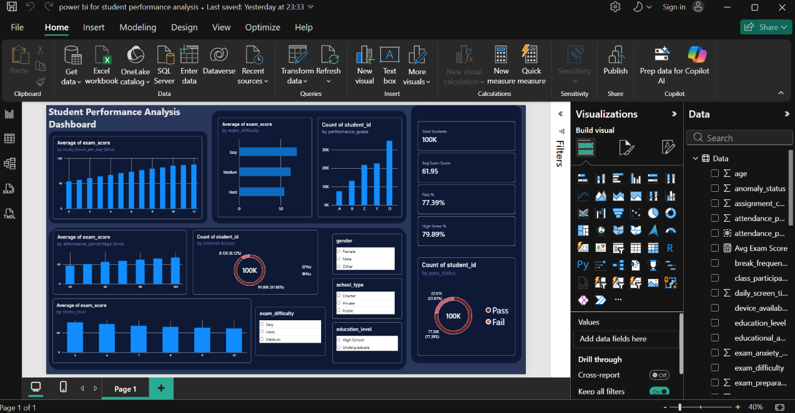

# Student Performance Analysis

**Subject:** Data Visualization and Preprocessing using Python
**Domain:** Education | SDG 4: Quality Education
**Author:** Bandari Rishika | Roll No: BETN1DS25023

## Problem Statement
A student's exam marks alone do not tell us why some students perform better than others. This project finds which factors (attendance, previous GPA, study habits, stress, family background and more) are related to students' exam performance.

## Objectives
- Clean and preprocess the dataset using Python, Pandas and NumPy.
- Analyse key factors such as attendance, GPA, study hours and exam score.
- Use AI-assisted tools to find extra patterns.
- Present the findings in an interactive Power BI dashboard.

## Dataset
- Student Exam Performance dataset: 100,000 students, 44 columns.
- Includes background, study habits, wellbeing and exam results.

## Tools Used
- Python (Pandas, NumPy, Matplotlib, Seaborn, PyWaffle, WordCloud) in Google Colab
- Sweetviz (automated data report)
- Isolation Forest (anomaly detection)
- Power BI (dashboard)

## What Was Done
1. **Data checking:** shape, data types, summary, duplicates (none found).
2. **Missing values:** 52,161 values filled with the median (numbers) and "Unknown" (text).
3. **Validation and outliers:** ranges checked; outliers found with IQR and kept because they are valid.
4. **Encoding and scaling:** ordinal, one-hot and binary encoding; RobustScaler.
5. **Analysis:** correlation, ANOVA, grouping and aggregation.
6. **AI-assisted analysis:** Sweetviz report and Isolation Forest anomaly detection.
7. **Visualization:** bar, line, histogram, box, scatter, pie, bubble, waffle, word cloud and heatmap.
8. **Dashboard:** interactive Power BI dashboard with KPI cards, 7 charts and 4 slicers.

## Key Findings
- Previous GPA (0.45) and study hours (0.36) have the strongest link with exam score.
- Exam difficulty has the biggest effect: Easy exams average about 69 and Hard about 54.
- Higher stress means lower scores (about 76 down to 60).
- Attendance has a small effect (0.16).
- Gender, school type, internet access, motivation and study consistency show almost no difference.
- 77% of students pass and 23% fail.

## Dashboard

## Files
- `pbl_checking.ipynb` - Colab notebook (cleaning, analysis and charts)
- `student_exam_performance_zip.zip` - original dataset (zipped)
- `Student_Performance_Cleaned (1)_zip.zip` - cleaned dataset (zipped)
- `power bi for student performance analysis.pbix` - Power BI dashboard
- `Student_Performance_Analysis.pptx` - presentation
- `dashboard.png` - dashboard screenshot
